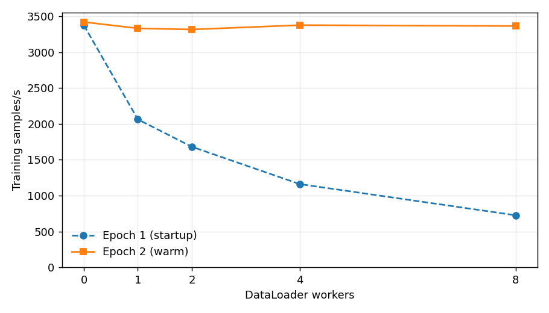
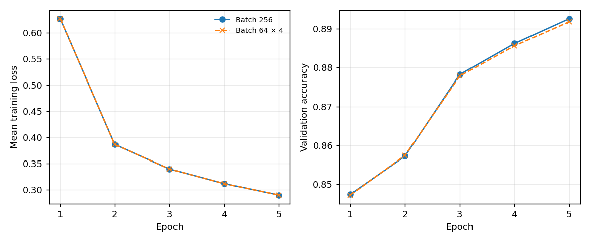
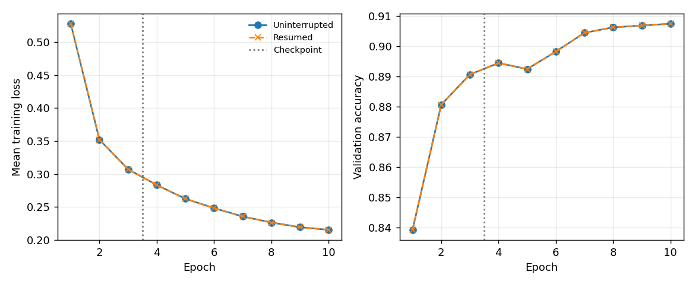

# Lab 6 — Training pipelines and project proposal

## 1. Configuration and tracking

The CNN selected in [Lab 3](https://github.com/C0ns1gl1ere/ml-systems-labs/blob/main/lab03/report.md) had 20,490 parameters and 89.64% held-out test accuracy. This lab trains the same architecture from a seeded initialization on the same 55,000/5,000 Fashion-MNIST split, with the same per-image pixel normalization. Comparisons use validation accuracy. The test split is reserved for final model evaluation outside these sweeps. All runs use channels-last PyTorch tensors and the same sample order per epoch. Each run takes one YAML config and saves an atomic epoch checkpoint. The MLflow snapshot in the submission ZIP contains 19 completed runs with parameters, epoch metrics, and artifacts. The [run inventory](results/mlflow_runs.json) records run IDs and verified metric steps. [Environment](results/environment.json) records the CPU device, 4 PyTorch threads, OS and exact package versions.

## 2. One-epoch PyTorch profile

| Phase | Milliseconds | Share |
| --- | --- | --- |
| data_loading | 598.8 | 2.4% |
| forward | 10,879.2 | 44.1% |
| backward | 9,990.1 | 40.5% |
| optimizer_step | 3,190.5 | 12.9% |

Shares use the sum of the four inclusive profiler regions. Data loading includes batch fetching and input transfer. Forward includes the loss calculation. Backward computes summed gradients. The optimizer region normalizes gradients by sample count, updates weights and clears gradients. Profiling is separate from throughput measurements. The annotated phase trace in the submission ZIP preserves start times and durations for the four measured regions. The largest measured region was **forward** (44.1%).

## 3. DataLoader worker sweep

| Workers | Cold samples/s | Warm samples/s | Peak tree RSS (MiB) |
| --- | --- | --- | --- |
| 0 | 3,375 | 3,419 | 448.3 |
| 1 | 2,063 | 3,331 | 744.3 |
| 2 | 1,681 | 3,316 | 1040.0 |
| 4 | 1,161 | 3,376 | 1619.3 |
| 8 | 726 | 3,364 | 2725.2 |

Epoch 1 includes worker startup. Epoch 2 reuses persistent workers. The fastest warm setting was **0 workers**. All warm results were within 3.0% of the fastest. The slowest cold result used 8 workers at 726 samples/s, versus 3,375 with zero workers. Batch loading accounted for 2.4% of profiled time and forward/backward for 84.6%. The main steady-state bottleneck on this machine was model computation, and spawning worker processes added a substantial first-epoch cost.

## 4. Batch-size study

| Batch | Samples/s | Peak tree RSS (MiB) | Peak CUDA (MiB) | Epoch 5 val. acc. |
| --- | --- | --- | --- | --- |
| 32 | 2,340 | 439.2 | — | 90.88% |
| 64 | 2,939 | 439.7 | — | 90.36% |
| 128 | 3,378 | 448.1 | — | 89.60% |
| 256 | 3,677 | 493.0 | — | 89.26% |
| 512 | 2,722 | 539.1 | — | 88.00% |

Throughput is total training samples divided by total elapsed training-epoch time. Evaluation, checkpoint writes and tracking calls are outside the timing. Peak memory is the maximum sampled sum of process-tree RSS at 25 ms intervals during training, including shared pages in each process that maps them. CUDA reports the maximum allocated tensor memory when used. Batch **256** gave the highest throughput (3,677 samples/s) with 493.0 MiB sampled RSS. Batch **32** gave the highest epoch-five accuracy (90.88%) with 439.2 MiB sampled RSS. Smaller batches take more optimizer steps per epoch. A fixed epoch budget therefore measures the combined effect of batch size and update count. The per-epoch timings show variation on this Windows host, so the throughput ranking applies to these five-epoch runs.

## 5. Optimizer and scheduler comparison

| Optimizer | Schedule | Start LR | Epoch 10 LR | Epoch 10 val. acc. | Best val. acc. |
| --- | --- | --- | --- | --- | --- |
| SGD | StepLR | 0.05 | 0.00625 | 91.72% | 91.72% |
| SGD | CosineAnnealingLR | 0.05 | 0.0017114 | 91.98% | 91.98% |
| SGD | ReduceLROnPlateau | 0.05 | 0.05 | 90.52% | 90.52% |
| ADAM | StepLR | 0.001 | 0.000125 | 90.58% | 90.78% |
| ADAM | CosineAnnealingLR | 0.001 | 3.4227e-05 | 90.74% | 90.74% |
| ADAM | ReduceLROnPlateau | 0.001 | 0.001 | 90.80% | 90.92% |

Each combination trained for ten epochs. These learning-behavior runs can run concurrently. Their timings are outside the isolated throughput comparison. SGD uses momentum 0.9. The initial learning rate is fixed across schedules within each optimizer. StepLR multiplies it by 0.5 every 3 epochs. Cosine anneals over all ten epochs to 1% of the initial rate. ReduceLROnPlateau monitors validation loss with patience 1 and factor 0.5. Epoch 10 LR is the rate used for the final optimization pass before the scheduler updates. **SGD with CosineAnnealingLR** had the highest final validation accuracy (91.98%) for these starting rates and this seed.

## 6. Accumulation

A true batch of 256 and four microbatches of 64 see the same samples before each update. Summed gradients are divided by the actual number of examples in each window, including the final partial window. The largest epoch training-loss gap was 6.00142e-05. The final validation-accuracy gap was 0.0800 percentage points. The true-batch curve is reused from the identical batch-size run. The [similarity check](results/accumulation_check.json) uses limits of 0.02 for loss and one percentage point for accuracy.

## 7. Checkpoint and resume

The uninterrupted reference is the identical Adam + cosine run from the scheduler study. The interrupted process exited after saving epoch 3. A fresh process restored weights, optimizer, scheduler, RNG states, epoch history and the original MLflow run ID. It continued at epoch 4 through epoch 10. The final maximum absolute parameter gap was 0 and the maximum learning-rate or metric gap was 0. The [resume check](results/resume_check.json) records exact weight equality and a 1e-6 tolerance check.

## 8. Individual proposal

[CPU deployment of a quantized clothing classifier](proposal.md). Instructor approval is pending.

## Reading

Vijay Janapa Reddi, *Machine Learning Systems*. The assigned training chapter frames the phase breakdown and trade-offs in worker prefetching and accumulation. The model development and MLOps readings motivate fixed validation data, logged run configurations, and repeatable checkpoint recovery. [Textbook](https://mlsysbook.ai/book/assets/downloads/Machine-Learning-Systems.pdf)
