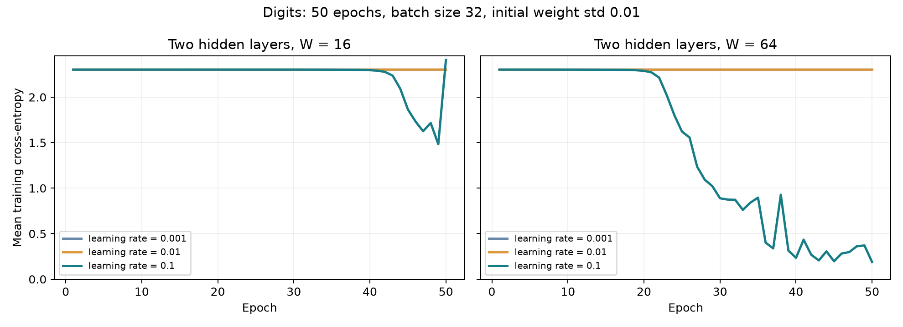

# Lab 2: A neural network from scratch

## 1. Data and network

The goal was to build a neural network with NumPy and compare different hidden-layer sizes and learning rates.

The `load_digits` dataset has 1,797 images of digits from 0 to 9. Each image has 64 pixel values. Inputs were divided by 16, and labels were one-hot encoded. A stratified 70/30 split with `random_state=42` gave 1,257 training examples and 540 test examples.

The network has two hidden layers:

```text
64 inputs -> W units -> ReLU -> W units -> ReLU -> 10 outputs -> softmax
```

Both W=16 and W=64 were tested. The parameter shapes are:

| Layer | Weights | Biases |
|---|---|---|
| First hidden layer | (64, W) | (W,) |
| Second hidden layer | (W, W) | (W,) |
| Output layer | (W, 10) | (10,) |

Weights were initialized with mean 0 and standard deviation 0.01. Biases were initialized to zero.

## 2. Forward pass and gradients

Each hidden layer applies a matrix multiplication, adds a bias, and applies ReLU. Softmax turns the final values into 10 probabilities. The largest value in each row is subtracted before softmax for numerical stability.

```text
Z1 = X @ W1 + b1;    A1 = max(0, Z1)
Z2 = A1 @ W2 + b2;   A2 = max(0, Z2)
Z3 = A2 @ W3 + b3
P = softmax(Z3)
```

The loss is mean cross-entropy:

$$
L=-\frac{1}{m}\sum_{i,k}Y_{ik}\log P_{ik}.
$$

For a batch of size m, combining the softmax and cross-entropy derivatives gives `D3 = (P - Y) / m`. Applying the chain rule to the remaining layers gives:

```text
dW3 = A2.T @ D3;               db3 = sum_rows(D3)
D2 = (D3 @ W3.T) * (Z2 > 0)
dW2 = A1.T @ D2;               db2 = sum_rows(D2)
D1 = (D2 @ W2.T) * (Z1 > 0)
dW1 = X.T @ D1;                db1 = sum_rows(D1)
```

The ReLU masks pass gradients only where the layer input is positive. Parameters are updated using `parameter -= learning_rate * gradient`.

### Checks

The output shape was `(batch_size, 10)`, and each probability row summed to 1 within `1e-6`. Initial losses were 2.30258552 for W=16 and 2.30259249 for W=64, close to `ln(10) = 2.302585`.

For each width, 10 random weights were checked using perturbations of `+1e-5` and `-1e-5`:

```text
numerical = (loss_plus - loss_minus) / (2 * 1e-5)
relative_error = abs(numerical - analytical) / max(1e-12, abs(numerical) + abs(analytical))
```

Checks used the trained learning-rate-0.1 model, the first 32 training examples, and sampling seed 2026. No weights were resampled. The required relative error was below `1e-6` for at least 9 of 10 weights.

| Width | Passed | Maximum relative error |
|---|---|---|
| 16 | 10/10 | 2.835e-09 |
| 64 | 10/10 | 4.662e-08 |

Full checks are in [gradient_check.csv](results/gradient_check.csv).

## 3. Training results

All six runs used 50 epochs and mini-batches of 32. Training data was shuffled each epoch. Initialization seed 42 and shuffle seed 123 were reused for each run. Test data was used only for final evaluation.

| Width | Learning rate | Final training loss | Test accuracy |
|---|---|---|---|
| 16 | 0.001 | 2.302550 | 10.19% |
| 16 | 0.01 | 2.302479 | 10.19% |
| 16 | 0.1 | 2.407343 | 23.89% |
| 64 | 0.001 | 2.302526 | 10.19% |
| 64 | 0.01 | 2.302344 | 10.19% |
| 64 | 0.1 | 0.188314 | 90.74% |



The smaller learning rates made little progress in 50 epochs. With learning rate 0.1, W=64 achieved the best result: **490 correct predictions out of 540 (90.74%)**. W=16 had a loss spike near the end, showing unstable training in that run.

## 4. Timing

Forward and backward passes were timed separately on batches of 32. The table shows the median of 100 runs after 20 warm-up iterations, using one BLAS thread. Backward used a saved forward cache. Data loading, parameter updates, and explicit loss calculation were excluded.

| Width | Forward (ms) | Backward (ms) |
|---|---|---|
| 16 | 0.028600 | 0.028700 |
| 64 | 0.043250 | 0.054050 |

For W=16, the times were nearly equal. For W=64, backward took about 25% longer. Forward uses three matrix multiplications; backward uses five to calculate weight gradients and pass errors through the hidden layers. Larger matrices increase this cost. Timing depends on the computer used.

## 5. Conclusion

The network passed the output, loss, and gradient checks. The best final test accuracy was 90.74%, using W=64 and learning rate 0.1. These results describe one run per configuration; other random seeds may give different results.

To run the program from `lab02`:

```bash
python -m pip install -r requirements.txt
python lab2.py
```

The graph and result tables are saved in `results/`.
