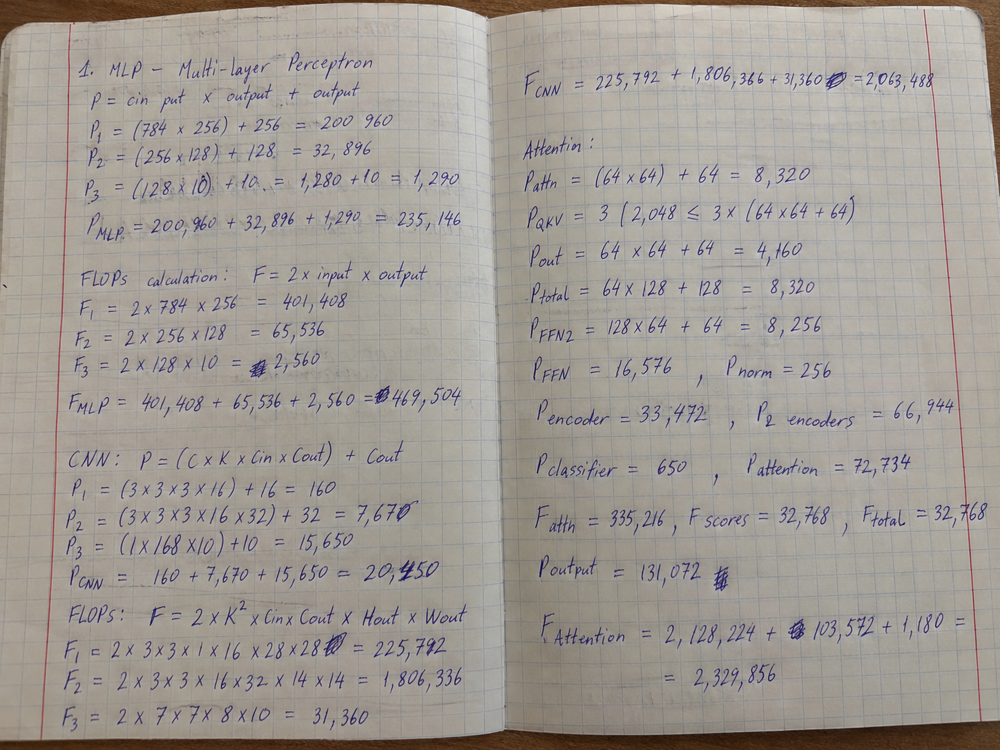
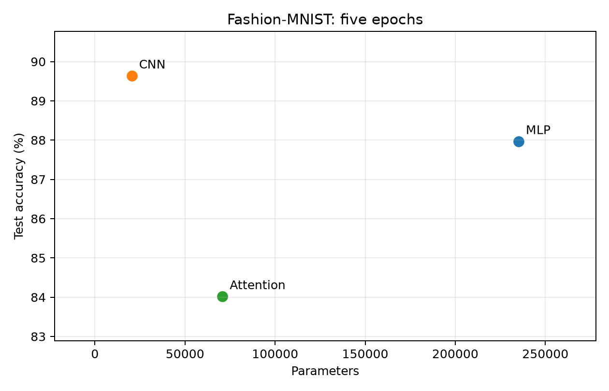
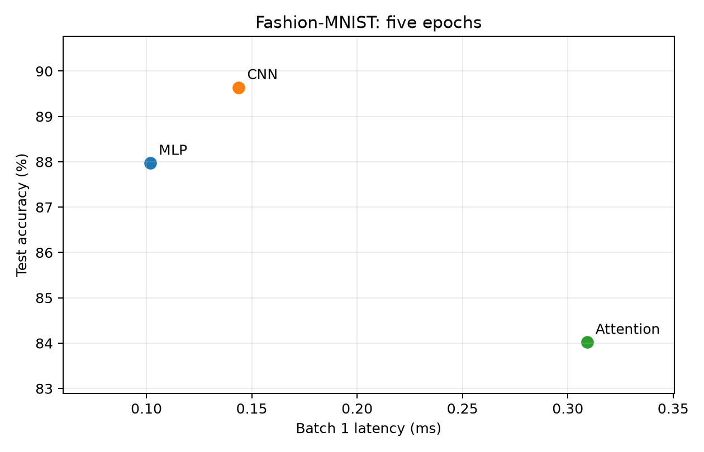

# Lab 3: Architectures and their costs

## Protocol
Fashion-MNIST official 60,000 training images split into 55,000 train and 5,000 validation with seed 42; official 10,000 test images. ToTensor and Normalize((0.2860,), (0.3530,)). All models: Adam, learning rate 0.001, batch 128, five epochs. Test evaluated once after the final epoch; validation is recorded each epoch. Device: cpu; Python 3.11.8, PyTorch 2.14.1+cpu; CPU: Intel64 Family 6 Model 186 Stepping 3, GenuineIntel; threads: 4. No claim of bitwise reproducibility across platforms. No positional embeddings are added because the specification does not request them; this limits spatial information in the attention model.

## Architecture discrepancy
The exact specified MLP has 235,146 parameters, CNN 20,490, and attention 70,794. Thus the requested 100k-150k size target conflicts with the explicit layer definitions. This experiment preserves the explicit definitions. Parameter count is therefore a confounder, and this is not a controlled comparison at equal size. Attention uses PyTorch encoder defaults (ReLU, dropout 0.1, post-normalization, biases).

## Results
| Model | Parameters | Test accuracy | Batch 1 median ms | Batch 128 median ms |
|---|---:|---:|---:|---:|
| MLP | 235,146 | 87.97% | 0.102 | 0.611 |
| CNN | 20,490 | 89.64% | 0.144 | 12.131 |
| Attention | 70,794 | 84.02% | 0.309 | 4.601 |

Latency excludes data loading and host/device transfer. Synthetic tensors already reside on the device. Evaluation mode and inference_mode; 20 warm-up runs per batch size, then median of 100 runs for batch 1 and 20 for batch 128. CUDA synchronization brackets timings when relevant. Batch latency is not per-image latency; divide batch-128 time by 128 for amortized cost. These are local measurements, not hardware-independent properties.

## Hand calculation
Multiply and add count as two FLOPs; biases, activations, pooling, normalization, and softmax are excluded from the analytical matrix-operation baseline.

* MLP first Linear: 2*784*256 = 401,408 FLOPs. Parameters: 784*256+256 = 200,960. Whole model: 2*(784*256+256*128+128*10) = 469,504.
* CNN first convolution: 2*3*3*1*16*28*28 = 225,792 FLOPs. Parameters: 3*3*1*16+16 = 160. Second convolution: 2*3*3*16*32*14*14 = 1,806,336. Classifier: 2*1568*10 = 31,360. Total = 2,063,488.
* Attention sequence length 16, width 64, four heads of width 16. QKV per encoder: 2*16*64*3*64 = 393,216; QK^T: 2*16^2*64 = 32,768; attention-times-V: 32,768; output projection: 2*16*64*64 = 131,072. Attention subtotal = 589,824. Feed-forward: 2*16*(64*128+128*64) = 524,288. Two encoders = 2,228,224. Patch projection = 2*16*49*64 = 100,352; head = 1,280. Whole model = 2,329,856 FLOPs.

### Handwritten working

The supplied photo records the MLP, CNN, and attention working. The typed derivations above give the values used in the profiling comparison.

## Profiling comparison
| Model | Analytical matrix FLOPs | Raw THOP MACs | Hook-adjusted THOP x2 |
|---|---:|---:|---:|
| MLP | 469,504 | 234,752 | 469,504 |
| CNN | 2,063,488 | 1,031,744 | 2,063,488 |
| Attention | 2,329,856 | 591,488 | 2,362,624 |

THOP primarily reports MACs rather than two-operation FLOPs. Raw THOP can omit MultiheadAttention functional operations. The custom hook counts QKV, output projection, scores, and weighted values. LayerNorm and other operations may be counted with tool-specific conventions, so doubling all reported operations is only an approximation. For MLP and CNN, twice the THOP MAC count exactly matches the analytical baseline. Attention raw THOP misses the attention submodule: the custom hook restores 589,824 MACs. The remaining 32,768-operation difference after doubling is the four LayerNorm modules counted by THOP (1.41% of the analytical baseline). torchinfo layer summaries are saved separately. Analytical FLOPs exclude non-matrix operations, and parameter storage alone does not predict latency.

## Trade-offs and access patterns

Highest observed test accuracy: CNN. CNN also has the fewest parameters, making it the strongest accuracy/storage choice in this experiment. It improves accuracy over MLP by 1.67 percentage points with approximately 11.5 times fewer parameters. MLP is the fastest for both measured batch sizes. Attention is less accurate and slower than MLP, so it offers no observed accuracy/latency advantage here. The CNN reuses small kernels over local neighborhoods and shares weights, reducing parameter storage but creating feature-map traffic. Pooling reduces downstream activation sizes. The MLP streams a larger dense weight matrix; batch 1 offers limited weight reuse, while batching reuses weights across images and improves matrix multiplication efficiency. Attention projects tokens with dense operations and forms score matrices; score storage grows quadratically with token count. At only 16 tokens, launch/dispatch, normalization, softmax, and small matrix operations can dominate. Batching improves utilization but increases activation memory. These access-pattern interpretations follow the lab's Chapter 4.6-4.7 topics; the chapter text was not supplied, so no direct quotations are claimed.

Cost-effectiveness depends on the constraint: use the table and plots to compare accuracy, parameter memory, and measured latency together. A higher-FLOP model can still run faster because FLOPs omit memory traffic and execution overhead. Five epochs and one seed provide an initial comparison, not statistical proof of architectural superiority.

## Reproduce
From `lab03`, install requirements.txt, then run `python src/lab3.py --data PATH_TO_DATA --threads 4`. Results, training history, plots, summaries, and final model weights are written in `lab03/results/`; the report is written to `lab03/report.md`. These output paths are independent of the working directory. Without `--data`, the dataset cache defaults to `lab03/data/`. The first run downloads Fashion-MNIST.

