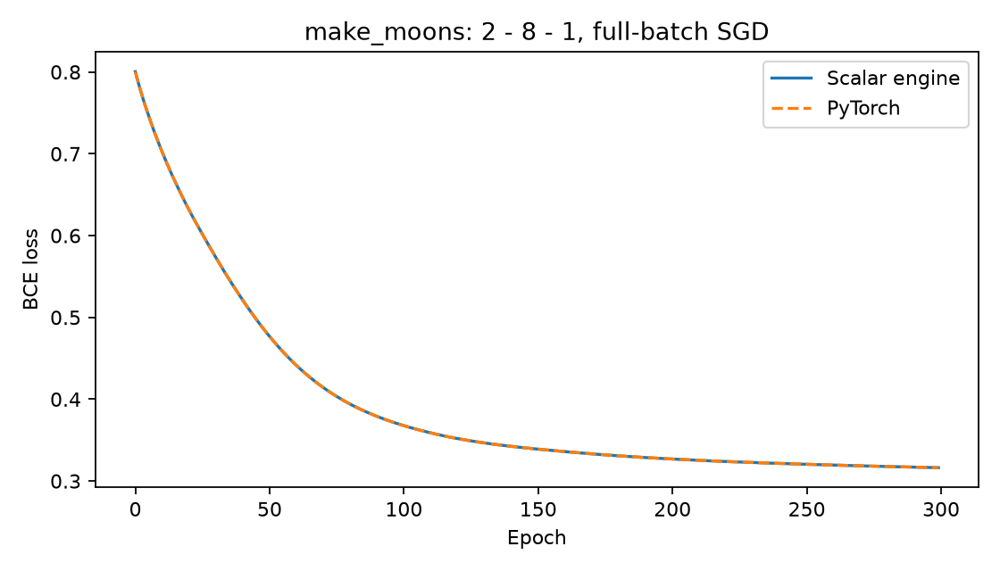

# Звіт: Lab 5 — Frameworks and automatic differentiation

Дата виконання: 4 листопада 2026 року.

## 1–3. Власний autograd

Реалізовано клас Value: data, grad, parents та локальне правило _backward. Операції +, *, ** і ReLU створюють граф під час forward. Backward виконує ітеративне топологічне сортування, задає градієнт виходу 1 та обходить граф у зворотному порядку. Усі локальні внески додаються через +=. Перед новим backward градієнти обнуляються. Перевірено спільний вузол x*x+x (при x=3 градієнт 7), повторний backward і ReLU на від'ємному вході.

## 4. Перевірка градієнтів

Вираз: `((a*b+c)**2).relu().sum()`. Використано float64, три набори входів та центральну різницю з кроком 1e-6.

Максимальна абсолютна похибка проти PyTorch: **0.000e+00**.

Максимальна абсолютна похибка проти чисельного градієнта: **4.202e-10**.

Обидва результати менші за 1e-6. Докладні градієнти для a, b, c наведено в results.json.

## 5. Навчання make_moons

Архітектура 2→8→1: Linear, ReLU, Linear, sigmoid; BCE. Для стійкості обчислюється еквівалентний BCE з логітів. Дані: 200 точок, noise=0.15, seed=42, розбиття 150/50 зі stratify. 300 епох, full-batch SGD, lr=0.1, float64, CPU. Однакові початкові ваги в обох реалізаціях; попередній прогрів не входить у час. У час входить увесь навчальний цикл, без створення моделі й оцінювання.

| Запуск | Власний рушій, с | PyTorch, с |
|---|---:|---:|
| 1 | 115.209244 | 0.492715 |
| 2 | 111.963950 | 0.503227 |
| 3 | 86.639719 | 0.184864 |
| 4 | 59.110257 | 0.124862 |
| 5 | 56.757831 | 0.140315 |
| Медіана | 86.639719 | 0.184864 |

PyTorch швидший у **468.67 раза** за відношенням медіан. Це також ефект векторизації: PyTorch обробляє весь пакет тензорами, а Value виконує скалярні Python-операції.

Час помітно зменшується в пізніших запусках для обох реалізацій. Порядок завжди був Value, потім PyTorch; фонове навантаження не контролювалося. Тому відношення медіан є локальним описовим результатом, а не стабільною оцінкою прискорення для інших умов.

Фінальний train BCE: власний **0.31629219**, PyTorch **0.31629219**. Test accuracy: власний **90.0%**, PyTorch **90.0%**. Максимальна різниця loss між реалізаціями за всі епохи: **5.551e-16**. Це один фіксований поділ даних, а не оцінка статистичної невизначеності якості.

## 6. Графи, режими виконання та тензори

Вузли графа autograd: AddmmBackward0, TBackward0, AccumulateGrad, ReluBackward0, AddmmBackward0, TBackward0, AccumulateGrad, AccumulateGrad, AccumulateGrad. AccumulateGrad відповідає листовим параметрам; AddmmBackward — лінійному шару, ReluBackward — активації. Граф tracing збережено в traced_graph.txt.

Порівняно eager і дозволений методичкою torch.jit.trace. Час побудови trace: **0.099825 с**. Після прогріву 30 викликів виконано п'ять серій по 500 inference-викликів, no_grad, пакет 150×2.

Встановлена версія PyTorch вивела попередження про застарівання torch.jit.trace, але виконання успішне. Метод обрано як прямо дозволену альтернативу з методички.

| Режим | Медіана, мкс/виклик |
|---|---:|
| Eager | 36.607 |
| Traced | 26.757 |

Відношення eager/traced: **1.368**. Максимальна різниця виходів: **0.000e+00**.

За цим вимірюванням підготовка trace окупається приблизно після **10,134 викликів**.

Tracing може зменшити накладні витрати повторних викликів, але його підготовка потребує часу. Найбільший сенс він має для багатьох повторень зі стабільним графом. Для одноразового запуску або обчислень, де домінують великі матричні операції, користь може бути малою. Цей експеримент використовує tracing; прискорення torch.compile не вимірювалося. Trace залежних від даних Python-розгалужень може зафіксувати лише один шлях.

Тест пам'яті: транспонований view і його contiguous-копія мають однакові значення та shape [512, 512], dtype torch.float64. Strides view: [1, 512]; копії: [512, 1]. is_contiguous: view=False, копія=True.

| Операція | Медіана, мкс |
|---|---:|
| Non-contiguous view @ weight | 8987.613 |
| Contiguous copy @ weight | 8809.310 |
| Створення contiguous-копії | 534.744 |

Для множення: прогрів 30 викликів, п'ять серій по 30 операцій. Вартість копіювання виключено з порівняння множень і виміряно окремо (п'ять серій по 100 викликів). Відношення non-contiguous/contiguous: **1.020**. Значення понад 1 означає уповільнення view. Цей результат стосується транспонованої матриці 512×512 та операції mm; він не означає, що всі non-contiguous тензори мають таку саму поведінку. BLAS може ефективно працювати з транспонуванням. Примусове contiguous() додає ціну копіювання, яку потрібно враховувати при виборі оптимізації.

Різниця медіан близько 2% менша за розкид окремих серій. Цей тест не дає переконливих підстав стверджувати систематичне уповільнення через такий view.

## Середовище та відтворюваність

Python 3.11.8; PyTorch 2.15.0+cpu; NumPy 2.4.6; Windows-10-10.0.26200-SP0. CPU, один потік PyTorch. Точні версії залежностей збережено в environment.txt. Сирі вимірювання та перевірки — results.json. Значення часу залежать від комп'ютера та фонового навантаження; це локальні вимірювання без довірчих інтервалів.

Код: lab05.py або lab05.ipynb; інструкція: README.md. Усі шість технічних завдань із наданої методички виконано. Згаданий у листі підручник не надано і не використовувався як прочитане джерело; додаткові усні вимоги викладача не відомі.
