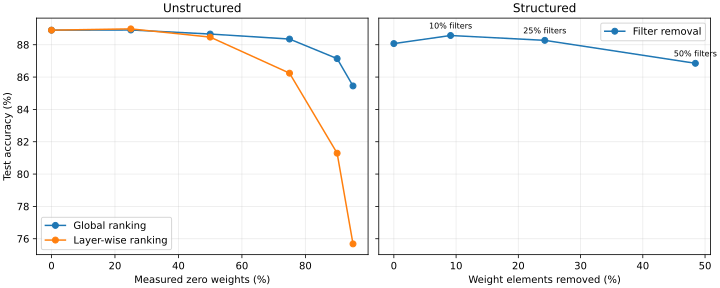

# Lab 07 · Compression through pruning and distillation

## Protocol

I trained on all 60,000 Fashion-MNIST training images and evaluated each variant on the 10,000 official test images. Images were normalized using mean 0.286 and standard deviation 0.353. The models share an average-pooling input stage, two convolution blocks, and a two-layer classifier. The teacher has 16/32 convolution channels and a 3,328-unit hidden layer. The student has 8/16 channels and a 640-unit hidden layer.

All runs used Adam, batches of 256, and fixed seeds. The baseline and both students trained for 5 epochs at a learning rate of 0.001. The students started from identical weights and saw the same shuffles. The distilled student used frozen teacher logits, temperature 4, and alpha 0.5. Its loss was 0.5 × cross-entropy + 0.5 × 4² × KL(student || teacher), with both distributions softened at temperature 4.

Each pruning setting starts from a fresh copy of the trained teacher. Unstructured pruning ranks absolute weights over all four weight tensors together or within each tensor. It leaves biases intact and holds each mask fixed through fine-tuning. Structured pruning ranks convolution filters by L2 norm in each original layer and removes them along with the corresponding downstream input channels and classifier columns. Filter counts are rounded per layer. All pruning runs fine-tune for three epochs at a learning rate of 0.0003. The 0% runs control for the additional optimization.

## Results by efficiency pillar

| Variant | Data · train/test | Model · test accuracy | Model · parameters | Model · dense / CSR MiB | Compute · dense MACs / image | Compute · CPU median µs | Energy · runtime proxy (training s)¹ |
|---|---:|---:|---:|---:|---:|---:|---:|
| Baseline teacher | 60k / 10k | 88.07% | 999,882 | 3.817 / 7.634 | 1,245,760 | 1414.7 | 66.8 |
| Plain student | 60k / 10k | 85.75% | 100,458 | 0.386 / 0.772 | 169,120 | 778.3 | 38.1 |
| Distilled student | 60k / 10k | 85.14% | 100,458 | 0.386 / 0.772 | 169,120 | 276.8 | 35.5 |
| Global 0% | 60k / 10k | 88.90% | 999,882 | 3.817 / 7.634 | 1,245,760 | 1415.6 | 62.2 |
| Global 25% | 60k / 10k | 88.91% | 999,882 | 3.817 / 5.733 | 1,245,760 | 1207.8 | 65.4 |
| Global 50% | 60k / 10k | 88.66% | 999,882 | 3.817 / 3.832 | 1,245,760 | 702.7 | 61.9 |
| Global 75% | 60k / 10k | 88.35% | 999,882 | 3.817 / 1.932 | 1,245,760 | 610.8 | 39.4 |
| Global 90% | 60k / 10k | 87.14% | 999,882 | 3.817 / 0.791 | 1,245,760 | 661.6 | 37.1 |
| Global 95% | 60k / 10k | 85.45% | 999,882 | 3.817 / 0.411 | 1,245,760 | 621.0 | 36.8 |
| Layer-wise 0% | 60k / 10k | 88.90% | 999,882 | 3.817 / 7.634 | 1,245,760 | 628.7 | 35.6 |
| Layer-wise 25% | 60k / 10k | 88.98% | 999,882 | 3.817 / 5.733 | 1,245,760 | 614.2 | 36.3 |
| Layer-wise 50% | 60k / 10k | 88.47% | 999,882 | 3.817 / 3.832 | 1,245,760 | 611.8 | 36.8 |
| Layer-wise 75% | 60k / 10k | 86.24% | 999,882 | 3.817 / 1.932 | 1,245,760 | 1454.2 | 37.1 |
| Layer-wise 90% | 60k / 10k | 81.29% | 999,882 | 3.817 / 0.791 | 1,245,760 | 1444.1 | 60.0 |
| Layer-wise 95% | 60k / 10k | 75.68% | 999,882 | 3.817 / 0.411 | 1,245,760 | 1420.8 | 64.2 |
| Structured 10% | 60k / 10k | 88.57% | 909,049 | 3.470 / 6.941 | 1,105,630 | 1398.9 | 61.6 |
| Structured 25% | 60k / 10k | 88.27% | 758,202 | 2.895 / 5.790 | 900,304 | 1379.4 | 54.2 |
| Structured 50% | 60k / 10k | 86.85% | 517,098 | 1.975 / 3.950 | 583,072 | 577.1 | 38.1 |

¹ Training seconds and dense MACs describe runtime and work. No power readings were collected, so energy in joules and energy savings are undetermined. The student training times exclude the shared teacher training. Distillation additionally needs one teacher pass over the training set to cache logits.

The left plot uses measured zero weights. The right plot uses the fraction of teacher weight elements physically removed, with annotations for the target fraction of convolution filters. Structured models use ordinary dense tensors at reduced dimensions.

## Storage, latency, and conclusion

The dense artifact uses PyTorch serialization and the sparse artifact uses uncompressed NPZ with CSR values, 32-bit column indices, and 32-bit row pointers. Both store biases densely and include the model widths. The experiment reconstructed each CSR tensor and checked it against the original. At 95% global sparsity, CSR reduced the dense artifact size by 89.2%. At that target, global ranking retained 85.45% accuracy versus 75.68% for layer-wise ranking at nearly the same CSR size. The 75% global variant scored 88.35% while using 1.93 MiB in CSR. At low sparsity, the indices can outweigh the space saved by omitting zero values. Compare pruned accuracy with the 0% control as well as the teacher to account for the extra training epochs.

Latency times a preloaded FP32 image at batch size 1 on Intel64 Family 6 Model 186 Stepping 3, GenuineIntel with 4 PyTorch threads. For each model, 50 warm-up calls preceded nine blocks of 100 calls. The table reports the median block mean. The CSV includes the range across blocks. Measurements exclude image loading and serialization. MAC estimates cover convolution and linear layers and exclude pooling, activations and bias additions.

The plain and distilled students execute the same architecture, yet their medians were 778.3 and 276.8 µs. They were benchmarked sequentially. Even the two 0% cases of the same teacher had medians of 1415.6 and 628.7 µs. These runs do not isolate the effect of system load, scheduling, or clock speed. The latency difference cannot be attributed to distillation. Compare the benchmark ranges alongside the medians, especially when interpreting small differences between pruning variants.

Dense inference ran the baseline in 1414.7 µs and the two 95%-sparse variants in 621.0 µs (global) and 1420.8 µs (layer-wise). Dense CPU kernels execute the same tensor shapes even when many weights are zero. Sparse storage alone cannot change that computation. A sparse-aware kernel would need to save enough arithmetic to offset index reads and irregular memory access. At 50% filter pruning, the narrower model ran in 577.1 µs at 86.85% accuracy.

The distilled student scored 85.14% against 85.75% for the plain student, a -0.61 percentage-point change in this seed. Both have 90.0% fewer parameters than the teacher, which scored 88.07%. Use the sparse results to assess storage savings and the physically smaller models to assess dense CPU deployment. The distillation comparison describes one paired run, so its accuracy difference may vary across seeds.

[Raw measurements](results/metrics.csv) · [Run environment](results/environment.json)
